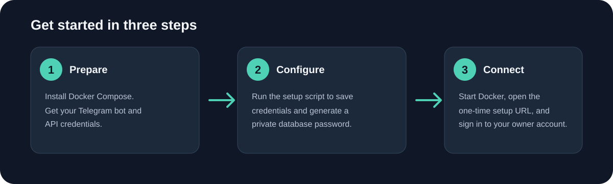

# Telegram Access Services

A self-hosted Telegram service that copies media and captions from posts your owner account can already access into the requesting user's private chat.

The service runs on your own machine with Docker Compose. PostgreSQL, the Telegram session, setup state, and temporary media are stored in Docker volumes. The database is private to the Compose network and is not published on a host port.



## Start in three steps

### 1. Prepare Telegram credentials and Docker

Install Docker Desktop on Windows or Docker Engine with the Docker Compose v2 plugin on Linux. Create a Telegram bot with [@BotFather](https://t.me/BotFather), and get your `API_ID` and `API_HASH` from [my.telegram.org](https://my.telegram.org). Get your numeric Telegram account ID from [@userinfobot](https://t.me/userinfobot).

Your owner Telegram account must already have access to the source chats. This software does not bypass Telegram access controls or join chats automatically.

### 2. Get the program and save your settings

Download or clone this repository, then open PowerShell in its folder:

```powershell
git clone https://github.com/ADISAK-PORNCHAROEN/telegram-access-services.git
Set-Location telegram-access-services
powershell -ExecutionPolicy Bypass -File scripts/setup.ps1 -Docker
```

The setup wizard asks for the bot token, API credentials, your Telegram ID, and a session name. It generates a database password on the first run and keeps that password when run again. The values are saved in `.env`; keep this file private and do not commit or share it.

On Linux, copy `.env.example` to `.env`, fill in the Telegram values, and generate a URL-safe database password with:

```sh
openssl rand -base64 32 | tr '+/' '-_' | tr -d '=\n'
```

Paste the output into `POSTGRES_PASSWORD` in `.env`. Keep the same password for this installation.

### 3. Start the service and finish first-run setup

```sh
docker compose up -d --build
docker compose logs -f app
```

Open the one-time setup URL shown in the app logs. It is available on the Docker host at `http://127.0.0.1:8765`. Complete the Telegram owner-session sign-in in the browser. When setup reports success, the service starts normally. The setup page closes after a working session is saved, and that session persists across container updates.

For a remote server, keep the setup port bound to loopback and create an SSH tunnel from your computer:

```sh
ssh -L 8765:127.0.0.1:8765 YOUR_USER@YOUR_SERVER
```

Then open the setup URL in your computer's browser. Replace the SSH placeholders with your server login. Do not expose the setup port to the public internet.

## Use the bot

Open a private chat with your Telegram bot and send a supported post link. The bot delivers results to that requesting private chat. The configured owner is the administrator and can grant or revoke access using `/grant`, `/revoke`, and `/users`.

The owner session can access only chats the owner account is already authorized to view. Telegram rate limits may delay work. File size and delivery limits are set by Telegram and the account type.

## Keep your installation safe

- Back up the PostgreSQL and application volumes before upgrades or moving the installation.
- Update with `docker compose up -d --build`. This recreates containers without deleting volumes.
- Never run `docker compose down -v` for an update. That command deletes persistent installation data.
- Store `.env` and backups securely. The app volume contains the Telegram session and setup data.
- Stop the app before taking a full backup so application state and database state remain consistent.

## Troubleshooting

```sh
docker compose ps
docker compose logs --tail=200 app
docker compose logs --tail=200 migrate
```

If the setup URL does not open on a remote host, confirm the SSH tunnel is running and use `127.0.0.1` in your local browser. If the app restarts, inspect the sanitized app and migration logs. Do not paste `.env`, session files, or setup tokens into support messages.

## Repository contents

This repository contains the runnable service, Docker installation files, and customer setup guidance. Development plans, Graphify output, local logs, Telegram sessions, and test databases belong outside this distribution.

See [the license terms](LICENSE.md) for the permitted internal use and restrictions on source redistribution.
